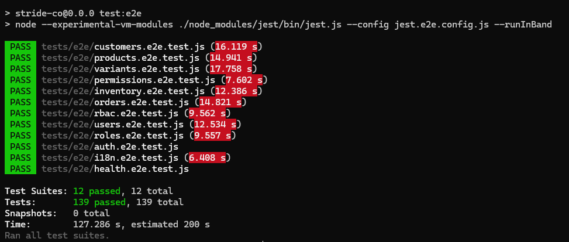

# Stride & Co.

## Datos académicos

| Campo | Detalle |
|---|---|
| **Universidad** | Universidad Autónoma de Chihuahua |
| **Facultad** | Facultad de Ingeniería |
| **Carrera** | Ingeniería en Computación |
| **Materia** | Desarrollo de Aplicaciones Web |
| **Docente** | Mtro. Luis Antonio Ramírez Martínez |
| **Actividad** | Proyecto 2: Backend completo, internacionalizado y desplegado sin costo  |
| **Equipo** | Equipo 3 |
| **Alumnos** | Kevin Andrés Rosales Rodríguez<br>Edwin Noé Zaragoza Alvarado<br>Nohemí Posada Atayde<br>Manuel Ramirez Contreras |
| **Matrículas** | 385814<br>385609<br>385520<br>385703 |
| **Fecha de entrega** | 08/11/2026 |

## Descripción

Stride & Co. es una tienda deportiva que actualmente gestiona parte de sus ventas y pedidos mediante mensajes de WhatsApp y procesos manuales.

El proyecto busca digitalizar la operación de la tienda mediante una aplicación web que permita centralizar la información del catálogo, controlar el inventario, registrar pedidos y facilitar la administración de usuarios, roles, permisos, clientes y productos.

Este repositorio corresponde al backend de la aplicación. En esta primera etapa se configuró la arquitectura inicial utilizando Node.js y Express, separando las rutas de los controladores y utilizando respuestas mock para comprobar el funcionamiento de la API.
El repositorio contiene una aplicación desarrollada con Node.js y Express, organizada por módulos y rutas, con lógica de negocio separada en controladores y soporte para autenticación mediante JWT.

La aplicación está orientada a servir como base para un sistema de administración de una tienda deportiva y a facilitar operaciones como alta de usuarios, gestión de productos, control de inventario y registro de pedidos.

## Objetivo

Configurar la base técnica inicial del backend de Stride & Co. utilizando Node.js y Express.

Se busca aplicar una arquitectura organizada basada en la separación de responsabilidades entre rutas y controladores, preparar los principales endpoints REST de la aplicación, incorporar logging de solicitudes HTTP, análisis de calidad de código, pruebas automatizadas y un flujo de trabajo colaborativo utilizando Git y GitHub.

La arquitectura general utilizada es:

```text
HTTP Request -> Express -> Route -> Controller -> Sequelize/Mongoose -> Database
```

## Tecnologías utilizadas


### Backend
- Node.js
- Express.js
- JavaScript
- Pug

### Base de datos
- PostgreSQL con Sequelize
- MongoDB con Mongoose

### Seguridad
- JWT
- express-jwt
- bcrypt
- AccessControl

### Configuración y utilidades
- Config
- i18N

### Herramientas y calidad
- Jest
- Supertest
- ESLint
- Morgan
- Supervisor
- Docker


## Requisitos previos
- Node.js 18 o superior
- npm
- Git
- PostgreSQL local (para Sequelize)
- MongoDB local (si se usa la configuración de Mongoose)
- Docker (opcional, para comprobar la imagen)

## Instalación

Clonar el repositorio:
```bash
git clone https://github.com/Mozeu/Stride-And-Co.git
cd Stride-And-Co
```

Instalar las dependencias:
```bash
npm ci
```

## Configuracion por entornos y secretos

El proyecto utiliza `config` para administrar los parametros de la app segun el entorno:

| Entorno | Archivo |
|---|---|
| Desarrollo | `config/development.json` |
| Pruebas | `config/test.json` |
| Producción | `config/production.json` |

### Configuracion local

Para usar `npm run setup:local`, Docker debe estar instalado y activo. Si aún no
tienes los contenedores, crea PostgreSQL y MongoDB así:

```bash
docker run --name stride-postgres -e POSTGRES_USER=root \
  -e POSTGRES_PASSWORD='CAMBIAR_ESTA_CONTRASENA' \
  -p 5432:5432 -v stride-postgres-data:/var/lib/postgresql/data -d postgres:16
docker run --name stride-mongo -p 27017:27017 \
  -v stride-mongo-data:/data/db -d mongo:8
```

Si ya existen los contenedores pero están detenidos, inícialos con
`docker start stride-postgres stride-mongo`.

Conéctate al PostgreSQL local como administrador:

```bash
docker exec -it stride-postgres psql -U root -d postgres
```

En `psql`, crea el rol y la base de desarrollo (usa una contraseña local
propia; `\password` la solicita sin mostrarla ni guardarla en el historial):

```text
CREATE ROLE stride_app LOGIN;
\password stride_app
CREATE DATABASE stride_co OWNER stride_app;
GRANT CONNECT, CREATE, TEMPORARY ON DATABASE stride_co TO stride_app;
\connect stride_co
GRANT USAGE, CREATE ON SCHEMA public TO stride_app;
GRANT ALL PRIVILEGES ON ALL TABLES IN SCHEMA public TO stride_app;
GRANT ALL PRIVILEGES ON ALL SEQUENCES IN SCHEMA public TO stride_app;
\q
```

Si el rol ya existe, usa `ALTER ROLE stride_app WITH LOGIN;` en lugar de
`CREATE ROLE`. Si `stride_co` ya existe, omite `CREATE DATABASE` y ejecuta los
comandos `GRANT` sobre esa base.

Todo este proceso de configuración de PostgreSQL es automático en
`setup-local.js`.

Después crea y protege el archivo privado:

```bash
cp config/local-development.example.json config/local-development.json
chmod 600 config/local-development.json
node -e "console.log(require('node:crypto').randomBytes(32).toString('hex'))"
```

En `config/local-development.json`, sustituye `postgres.password` por la misma
contraseña que asignaste a `stride_app`, `jwt.secret` por el secreto generado y
`mongo.uri` por la URI de tu MongoDB (por ejemplo,
`mongodb://127.0.0.1:27017/stride_co`). Para PostgreSQL fuera de Docker, ejecuta
el SQL desde `psql` local en lugar de `docker exec`.

### Variables de entorno

| Variable | Funcion |
|---|---|
| `NODE_ENV` | Selecciona desarrollo, pruebas o produccion |
| `PORT` | Configura el puerto del servidor (3000 por defecto) |

Ejecutar la aplicacion:

```bash
NODE_ENV=development npm start
```

Utilizar otro puerto:

```bash
NODE_ENV=development PORT=8080 npm start
```

JWT, PostgreSQL, MongoDB y bcrypt obtienen sus parametros mediante `config.get()`. La aplicacion requiere un secreto JWT válido para iniciar.

Los comandos y requisitos de las suites se describen en la sección
[Pruebas](#pruebas).

### API Publica: Produccion y Docker

El despliegue de producción utiliza Docker y Render.

#### Despliegue en Render

| Dato | Valor |
|---|---|
| URL pública | [https://stride-and-co.onrender.com](https://stride-and-co.onrender.com) |
| Health check y Health Check Path en Render | `GET /health` |
| Variable de entorno configurada | `NODE_ENV=production` |
| Tienda web | [https://stride-and-co.onrender.com/](https://stride-and-co.onrender.com/) |

El endpoint de salud responde `200` con `{"status":"UP"}`. Los usuarios de
demostración y sus credenciales están documentados en la
[matriz RBAC](#control-de-acceso-basado-en-roles).

Para probar F1 (inicio de sesión web) en `/login` se usa la cuenta `user@stride.test`; sus credenciales están en la [matriz RBAC](#control-de-acceso-basado-en-roles).

##### Bases de datos

| Servicio | Plan | Región | Detalles |
|---|---|---|---|
| Render PostgreSQL | Gratuito | Oregon (US West) | Fecha de creación reportada: 4 de noviembre de 2026 (por confirmar); fecha de caducidad: 4 de diciembre de 2026 |
| MongoDB Atlas | Cluster gratuito | AWS, Oregon (`us-west-2`) | Network Access permite `0.0.0.0/0` porque el plan gratuito de Render no tiene IP fija de salida |

La regla `0.0.0.0/0` permite conexiones desde cualquier IP por ello se
mantiene las credenciales de MongoDB privadas y limita los permisos de la cuenta
de base de datos.

##### Secretos de producción

`config/local-production.json` no se guarda en el repositorio ni se incluye en
la imagen Docker: `.gitignore` y `.dockerignore` excluyen los archivos
`config/local-*.json`. En Render se configura como **Secret File** del servicio,
con el nombre `local-production.json`. Render lo monta en `/etc/secrets/` y el
`Dockerfile` lo copia a `config/` al iniciar el contenedor.

El archivo contiene el secreto JWT, la URI de MongoDB y los datos de conexión a
PostgreSQL (host interno, usuario y contraseña).

##### Ejemplo de uso de la API pública

El ejemplo inicia sesión con la cuenta `user` de la tabla de demostración en la
[sección RBAC](#control-de-acceso-basado-en-roles), consulta productos y prueba
el acceso denegado a pedidos en español e inglés:

```bash
BASE=https://stride-and-co.onrender.com

curl "$BASE/health"

TOKEN=$(curl -s -X POST "$BASE/api/auth/login" \
  -H "Content-Type: application/json" \
  -d '{"email":"user@stride.test","password":"DemoUser!2026"}' \
  | node -pe 'JSON.parse(require("fs").readFileSync(0)).data.token')

# Recurso permitido (200)
curl -H "Authorization: Bearer $TOKEN" -H "Accept-Language: es" "$BASE/api/products"

# Recurso denegado (403), en español y en inglés
curl -H "Authorization: Bearer $TOKEN" "$BASE/api/orders?lang=es"
curl -H "Authorization: Bearer $TOKEN" "$BASE/api/orders?lang=en"
```

Construir la imagen:

```bash
docker build -t stride-config-check .
```

Verificar que no contiene archivos privados:

```bash
docker run --rm --entrypoint sh stride-config-check \
  -c 'find /app/config -name "local*.json" ! -name "*.example.json"'
```

La ejecucion completa requiere conexiones válidas a PostgreSQL y MongoDB.


## Scripts disponibles

| Comando | Descripción |
|---|---|
| `npm start` | Inicia el servidor de Express |
| `npm run dev` | Inicia el servidor en modo desarrollo |
| `npm run seed` | Crea roles, permisos y datos de demostración en PostgreSQL y MongoDB |
| `npm test` | Ejecuta las pruebas unitarias |
| `npm run lint` | Ejecuta ESLint para analizar la calidad del código |
| `npm run test:unit` | Ejecuta las pruebas unitarias con mocks |
| `npm run test:integration` | Ejecuta las pruebas de integración con bases de prueba |
| `npm run seed:products` | Crea productos de demostración en PostgreSQL |

## Recursos de la API

Actualmente la API cuenta con los siguientes recursos:

```text
/api/users
/api/roles
/api/permissions
/api/products
/api/variants
/api/inventory
/api/customers
/api/orders
```

Cada recurso se encuentra entre:

```text
routes/
controllers/
```

## Endpoints principales

La API expone recursos bajo el prefijo `/api`.

### Autenticación

```text
POST /api/auth/login
GET  /api/auth/me
```

### Usuarios

```text
GET    /api/users
GET    /api/users/:id
POST   /api/users
PUT    /api/users/:id
DELETE /api/users/:id
```

### Roles

```text
GET    /api/roles
GET    /api/roles/:id
POST   /api/roles
PUT    /api/roles/:id
DELETE /api/roles/:id
```

### Permisos

```text
GET    /api/permissions
GET    /api/permissions/:id
POST   /api/permissions
PUT    /api/permissions/:id
DELETE /api/permissions/:id
```

### Productos

```text
GET    /api/products
GET    /api/products/:id
POST   /api/products
PUT    /api/products/:id
DELETE /api/products/:id
```

### Variantes

```text
GET    /api/variants
GET    /api/variants/:id
POST   /api/variants
PUT    /api/variants/:id
DELETE /api/variants/:id
```

### Inventario

```text
GET  /api/inventory
GET  /api/inventory/:id
PUT  /api/inventory/:id
```

### Clientes

```text
GET    /api/customers
GET    /api/customers/:id
POST   /api/customers
PUT    /api/customers/:id
DELETE /api/customers/:id
```

### Pedidos

```text
GET    /api/orders
GET    /api/orders/:id
POST   /api/orders
PUT    /api/orders/:id
```

## Autenticación

La autenticación del backend usa `bcrypt` para proteger las contraseñas, `jsonwebtoken` para emitir tokens JWT y `express-jwt` para validarlos.

### Metodo para proteger contraseñas

En `utils/password.js` se usa `bcrypt.genSalt()` con el factor de costo configurado por `config.get('bcrypt.saltRounds')` para crear un salt y luego `bcrypt.hash(password, saltKey)` para generar el `password_hash`. La validación se realiza con `bcrypt.compare(password, passwordHash)`.

El modelo de usuario en `models/sql/User.js` almacena estos campos:

- `password_hash`
- `salt_key`

Esto permite conservar la contraseña protegida y verificarla sin exponer el valor original.

### Librerias para JWT

Se utiliza `jsonwebtoken` para firmar los tokens y `express-jwt` para verificar su firma, expiración, issuer y audience. El token usa el algoritmo `HS256` y contiene únicamente el identificador del usuario en `sub`. Estos valores se configuran mediante variables de entorno:

Los parámetros de JWT se administran mediante el paquete config, utilizando las propiedades jwt.secret, jwt.expiresIn, jwt.issuer y jwt.audience. El secreto se almacena en un archivo privado excluido del repositorio.

### Endpoint de login

```http
POST /api/auth/login
```

Ejemplo de cuerpo esperado:

```json
{
  "email": "usuario@correo.com",
  "password": "123456"
}
```

Respuesta esperada:

```json
{
  "message": "Login successful",
  "data": {
    "token": "<jwt_token>",
    "tokenType": "Bearer",
    "expiresIn": "15m"
  }
}
```

### Endpoint `/api/auth/me`

```http
GET /api/auth/me
```

Este endpoint requiere autenticación y devuelve la información del usuario autenticado sin incluir el `password_hash` ni el `salt_key`.
La autenticación se aplica a los endpoints bajo `/api`; las rutas fuera de ese prefijo no requieren token. `POST /api/auth/login` es la excepción pública para obtener el token.

### Header de autorización

Ejemplo del header enviado en peticiones protegidas:

```http
Authorization: Bearer <token>
```

El token expira después del valor configurado en `jwt.expiresIn` (15 minutos en el ejemplo).

### Cookie de sesión (web)

En las rutas web, el mismo JWT se guarda en la cookie `access_token` (`HttpOnly`, `SameSite=Lax` y `Secure` en producción) al iniciar sesión en `/login`. El middleware `authenticate` lee el token del header `Authorization` (API) o, si no existe, de esa cookie.

## Control de acceso basado en roles

La autorización usa RBAC con la librería `accesscontrol`. La autenticación (JWT) no cambia: el middleware `authorize` solo usa el usuario que ya deja `authenticate`, que se aplica de forma global a todo `/api`. Cada ruta protegida lleva `authorize(recurso, acción, alcance)`.

### Roles
- `admin`: administra todos los recursos.
- `sales`: consulta el catálogo, los usuarios y el inventario, actualiza el inventario, y gestiona clientes y órdenes de cualquier usuario.
- `user`: consulta el catálogo y opera solo sobre su propio usuario, su propio cliente y sus propias órdenes.

### Convención de permisos
Cada `Permission.key` tiene la forma `recurso:acción:alcance`, por ejemplo `orders:read:own`. El alcance es `own` (solo recursos del usuario) o `any` (cualquier recurso). Un rol con `any` también puede operar sobre lo propio.

### Permisos definidos y matriz RBAC
Los permisos definidos son los de la matriz. Solo existen permisos para las rutas que tiene la API: el inventario solo se consulta y se actualiza, y las órdenes no se eliminan.

| Permiso | admin | sales | user |
| --- | --- | --- | --- |
| `users:create:any` | Sí | No | No |
| `users:create:own` | Sí | Sí | Sí |
| `users:read:any` | Sí | Sí | No |
| `users:read:own` | Sí | Sí | Sí |
| `users:update:any` | Sí | No | No |
| `users:update:own` | Sí | Sí | Sí |
| `users:delete:any` | Sí | No | No |
| `roles:create:any` | Sí | No | No |
| `roles:read:any` | Sí | No | No |
| `roles:update:any` | Sí | No | No |
| `roles:delete:any` | Sí | No | No |
| `permissions:create:any` | Sí | No | No |
| `permissions:read:any` | Sí | No | No |
| `permissions:update:any` | Sí | No | No |
| `permissions:delete:any` | Sí | No | No |
| `products:create:any` | Sí | No | No |
| `products:read:any` | Sí | Sí | Sí |
| `products:update:any` | Sí | No | No |
| `products:delete:any` | Sí | No | No |
| `variants:create:any` | Sí | No | No |
| `variants:read:any` | Sí | Sí | Sí |
| `variants:update:any` | Sí | No | No |
| `variants:delete:any` | Sí | No | No |
| `inventory:read:any` | Sí | Sí | No |
| `inventory:update:any` | Sí | Sí | No |
| `customers:create:any` | Sí | Sí | No |
| `customers:read:any` | Sí | Sí | No |
| `customers:read:own` | No | No | Sí |
| `customers:update:any` | Sí | Sí | No |
| `customers:update:own` | No | No | Sí |
| `customers:delete:any` | Sí | No | No |
| `orders:create:any` | Sí | Sí | No |
| `orders:create:own` | No | No | Sí |
| `orders:read:any` | Sí | Sí | No |
| `orders:read:own` | Sí | Sí | Sí |
| `orders:update:any` | Sí | Sí | No |
| `orders:update:own` | Sí | Sí | Sí |

### Endpoints protegidos
Todos los endpoints bajo `/api` exigen token (401 si falta o no es válido) y el permiso de la tabla (403 si no lo tiene). Las excepciones son `GET /`, `GET /health` y `POST /api/auth/login` (sin autenticación ni autorización) y `GET /api/auth/me` (solo autenticación).

| Método y ruta | Permiso | Descripción |
| --- | --- | --- |
| `GET /` | ninguno | Página de bienvenida |
| `GET /health` | ninguno | Health check |
| `POST /api/auth/login` | ninguno | Inicia sesión y devuelve un JWT |
| `GET /api/auth/me` | cualquier usuario autenticado | Usuario actual sin hash ni salt |
| `POST /api/users` | `users:create:any` | Crea un usuario |
| `GET /api/users` | `users:read:any` | Lista usuarios |
| `GET /api/users/:id` | `users:read:own` o `any` | Obtiene un usuario |
| `PUT /api/users/:id` | `users:update:own` o `any` | Actualiza un usuario |
| `DELETE /api/users/:id` | `users:delete:any` | Elimina un usuario |
| `POST /api/roles` | `roles:create:any` | Crea un rol |
| `GET /api/roles` | `roles:read:any` | Lista roles |
| `GET /api/roles/:id` | `roles:read:any` | Obtiene un rol |
| `PUT /api/roles/:id` | `roles:update:any` | Actualiza un rol |
| `DELETE /api/roles/:id` | `roles:delete:any` | Elimina un rol |
| `POST /api/permissions` | `permissions:create:any` | Crea un permiso |
| `GET /api/permissions` | `permissions:read:any` | Lista permisos |
| `GET /api/permissions/:id` | `permissions:read:any` | Obtiene un permiso |
| `PUT /api/permissions/:id` | `permissions:update:any` | Actualiza un permiso |
| `DELETE /api/permissions/:id` | `permissions:delete:any` | Elimina un permiso |
| `POST /api/products` | `products:create:any` | Crea un producto |
| `GET /api/products` | `products:read:any` | Lista productos |
| `GET /api/products/:id` | `products:read:any` | Obtiene un producto con sus variantes |
| `PUT /api/products/:id` | `products:update:any` | Actualiza un producto |
| `DELETE /api/products/:id` | `products:delete:any` | Elimina un producto |
| `POST /api/variants` | `variants:create:any` | Crea una variante |
| `GET /api/variants` | `variants:read:any` | Lista variantes |
| `GET /api/variants/:id` | `variants:read:any` | Obtiene una variante |
| `PUT /api/variants/:id` | `variants:update:any` | Actualiza una variante |
| `DELETE /api/variants/:id` | `variants:delete:any` | Elimina una variante |
| `GET /api/inventory` | `inventory:read:any` | Lista el inventario |
| `GET /api/inventory/:id` | `inventory:read:any` | Obtiene un registro de inventario |
| `PUT /api/inventory/:id` | `inventory:update:any` | Actualiza el stock |
| `POST /api/customers` | `customers:create:any` | Crea un cliente |
| `GET /api/customers` | `customers:read:any` | Lista clientes |
| `GET /api/customers/:id` | `customers:read:own` o `any` | Obtiene un cliente |
| `PUT /api/customers/:id` | `customers:update:own` o `any` | Actualiza un cliente |
| `DELETE /api/customers/:id` | `customers:delete:any` | Elimina un cliente sin órdenes |
| `POST /api/orders` | `orders:create:own` o `any` | Crea una orden |
| `GET /api/orders` | `orders:read:any` | Lista órdenes con su cliente |
| `GET /api/orders/:id` | `orders:read:own` o `any` | Obtiene una orden con su cliente |
| `PUT /api/orders/:id` | `orders:update:own` o `any` | Actualiza una orden |
| `GET /login` | ninguno | Formulario de inicio de sesión (web) |
| `POST /login` | ninguno | Valida credenciales y guarda el JWT en una cookie (web) |
| `POST /logout` | ninguno | Elimina la cookie de sesión (web) |

Donde dice "own o any", la ruta pide `own` con una función que busca al dueño, y `any` también pasa.

### Ejemplo de permiso any
`GET /api/orders` exige `orders:read:any`. Un `user` recibe 403; `admin` y `sales` reciben 200.

### Ejemplo de permiso own
`GET /api/orders/:id` exige `orders:read:own` o `orders:read:any`. Con `own`, la orden debe pertenecer al usuario: se busca el cliente de la orden en MongoDB y se compara su `userId` con el id del usuario autenticado (`utils/checkOwnership.js`). Para `users:read:own` y `users:update:own`, el dueño es el propio usuario: el id de la URL debe ser el del usuario autenticado. Lo mismo aplica a `orders:update:own`, `customers:read:own` y `customers:update:own`. Para `orders:create:own`, el cliente indicado en el body debe pertenecer al usuario. Si no es suyo, la API responde 403.

### Origen de los permisos
Los permisos no están escritos en el código. `middleware/authorize.js` consulta `Role`, `role_permissions` y `Permission` en PostgreSQL, separa cada `key` en recurso, acción y alcance, y con eso configura `accesscontrol`. Los datos iniciales se cargan con `npm run seed`, que usa la misma matriz de este README (`scripts/seed-rbac.js`). Los permisos se cargan en memoria en la primera petición, por lo que hay que reiniciar el servidor después de correr el seed o de cambiar permisos.

### Decisiones del equipo
- El proyecto define sus propios métodos por recurso, por eso el inventario solo se consulta y se actualiza y las órdenes no se eliminan. Solo hay permisos para rutas que existen.
- Un usuario no puede eliminar su cuenta. Para darse de baja actualiza su usuario con `active: false` (`users:update:own`), el registro se conserva en la base de datos y el usuario ya no puede iniciar sesión. Eliminar usuarios es exclusivo del admin (`users:delete:any`).
- `users:create:own` está registrado, pero `POST /api/users` exige `users:create:any` hasta que exista un registro público (sign-up).
- Solo el admin administra roles y permisos. `sales` puede consultar todos los usuarios porque trabaja con clientes, y cada cliente está ligado a un usuario.
  
| Rol | Email | Contraseña |
|---|---|---|
| admin | `admin@stride.test` | `DemoAdmin!2026` |
| sales | `sales@stride.test` | `DemoSales!2026` |
| user | `user@stride.test` | `DemoUser!2026` |

Estas contraseñas son exclusivas de estas cuentas de demostración y no se usan en ningún otro lugar.

### Middleware allowFields

En el RBAC se planteó que un usuario tendría permiso para editar su propio usuario. Esto se estableció con la intención de permitir que un usuario actualice campos como su nombre, correo, contraseña y, como se mencionó anteriormente, su estado de activo como una forma de "eliminar" su cuenta.

Sin embargo, debido a estos permisos, también se le permite al usuario cambiar información sensible como el `user_id`, `rol_id` y, por consecuencia, sus permisos.

Para combatir esto, se creó el middleware [allowFields.js](middleware/allowFields.js), el cual usamos para limitar los campos que un usuario tiene permitido editar cuando el alcance es `"own"`. Dentro de las rutas (`routes`), se coloca después del middleware `authorize` y, dentro de sus parámetros, se especifican aquellos campos que está permitido modificar.

Esto se hace de esta forma para que cualquier campo nuevo que se añada en el futuro quede, por defecto, restringido para su edición.

Actualmente, el proyecto solo utiliza este middleware en `routes/users.js`, ya que esta se considera el área más crítica que se debe proteger. Sin embargo, también podría aplicarse a otras rutas, como `customers.js` y `orders.js`, aunque este ultimo requeriría restricciones adicionales dependiendo del estado de la petición.

## Funcionalidades SSR

| ID | Funcionalidad | Rutas | Permiso | Responsable | Evidencia |
|---|---|---|---|---|---|
| F2 | Inicio y catálogo | `GET /`, `GET /products` | Pública | — | [Inicio](docs/ssr/f2-inicio-productos-destacados.png) · [Búsqueda y filtro](docs/ssr/f2-catalogo-busqueda-y-filtro.png) · [Página 2](docs/ssr/f2-catalogo-pagina-2.png) · [HTML](docs/ssr/f2-catalogo-codigo-fuente.png) |
| F1 | Inicio y cierre de sesión | `/login`, `/logout` | Pública | Edwin Noé Zaragoza Alvarado | [docs/ssr/f1/](docs/ssr/f1/) |
| F4 | Bolsa de compra | `GET /cart`, `POST /cart/items`, `POST /cart/items/:variantId`, `POST /cart/items/:variantId/delete` | Pública | — | [Validación](docs/ssr/f4-bolsa-cantidad-supera-existencias.png) · [Bolsa vacía](docs/ssr/f4-bolsa-vacia-tras-retirar.png) · [HTML](docs/ssr/f4-bolsa-codigo-fuente.png) |

### F6 · Mis pedidos

| ID | Funcionalidad | Rutas | Permiso | Evidencia |
|---|---|---|---|---|
| F6 | Historial y detalle de pedidos propios | `GET /my/orders`, `GET /my/orders/:id` | `orders:read:own` | [Listado](docs/ssr/f6-mis-pedidos-listado.png) · [Detalle](docs/ssr/f6-mis-pedidos-detalle.png) · [Acceso denegado](docs/ssr/f6-mis-pedidos-acceso-denegado.png) · [HTML](docs/ssr/f6-mis-pedidos-codigo-fuente.png) |

Con PostgreSQL y MongoDB configurados, ejecuta `NODE_ENV=development npm run seed` para cargar los usuarios y pedidos de demostración, y `NODE_ENV=development npm start` para abrir la tienda. Inicia sesión como `user@stride.test` con las credenciales de la [matriz RBAC](#control-de-acceso-basado-en-roles). Abre **Mis pedidos** y pulsa **Ver detalle**.

Para comprobar el 403, inicia sesión como `sales@stride.test`, copia la URL de su pedido, cierra sesión y ábrela como `user@stride.test`. Para comprobar el 404, abre el detalle con un identificador válido que no exista. Las vistas usan los importes guardados en el pedido y muestran el nombre actual del producto cuando sigue en el catálogo.

### Cómo se guarda la sesión

1. `POST /login` valida el correo y la contraseña con `services/auth.service.js` (el mismo servicio que usa la API), rechaza a los usuarios inactivos y guarda el JWT en la cookie `access_token`.
2. `middleware/session.js` (`loadSession`) lee la cookie en cada petición web, carga al usuario con su rol y permisos, y lo deja en `req.user` y `res.locals.user`. Si el token no es válido o expiró, borra la cookie.
3. `requireLogin` redirige a `/login?returnTo=<url>` cuando no hay sesión; después de iniciar sesión se regresa a esa página. Solo se aceptan rutas internas en `returnTo`.
4. `POST /logout` elimina la cookie y regresa a `/`.
5. Los mensajes de confirmación (por ejemplo, "Inicio de sesión exitoso") viajan en una cookie de un solo uso que lee `middleware/flash.js`.

El JWT expira a los 15 minutos (`jwt.expiresIn`); después, el usuario aparece como sin sesión y debe iniciar sesión de nuevo.

### F4 · Bolsa de compra

En `/cart` se pueden agregar variantes, cambiar su cantidad y retirarlas. La cookie firmada guarda sus identificadores y cantidades. El servidor consulta PostgreSQL para calcular los importes y la disponibilidad (`stock - reserved`). Las líneas que excedan las existencias se conservan para su revisión y se excluyen del subtotal. La bolsa no reserva stock.

La bolsa funciona con o sin sesión y reutiliza los mensajes de confirmación del layout de F1. Las capturas manuales muestran el flujo de la bolsa con la cabecera previa a F1.

### Cómo agregar una pantalla nueva

1. **Servicio:** mover o crear la consulta en `services/<nombre>.service.js` (Sequelize / Mongoose).
2. **Controller:** crear `controllers/web/<nombre>.js` con `res.render(...)` o `res.redirect(...)`; los errores van a `next(err)`.
3. **Ruta:** definirla en `routes/web/<nombre>.js` y registrarla en `app.js`. Si es protegida: `requireLogin` y luego `authorize(recurso, acción, alcance)`.
4. **Vista:** crear `views/<carpeta>/<nombre>.pug` que extienda `layout`, y pasar `title` y `metaDescription` desde el controller.
5. **Traducciones:** agregar las claves en `locales/es.json` y `locales/en.json` al mismo tiempo; en Pug se usa `__('clave')`.

### F2 · Inicio y catálogo

El inicio destaca los cuatro productos activos más recientes. El catálogo busca por nombre o marca, filtra por `category_id` y muestra 12 productos por página. Prueba `/products?q=runner&category=1&page=2&lang=es` con datos que tengan categorías asignadas.

Las capturas manuales se tomaron antes de incorporar la cabecera de F1 y documentan el flujo del catálogo.

## Internacionalización (i18n)

La API responde en español (`es`) y en inglés (`en`) con la librería `i18n`. Los textos están en `locales/es.json` y `locales/en.json`, organizados por recurso, y en el código se traducen con `req.__('clave')`.

**Cómo se elige el idioma:** `?lang=es`, luego el header `Accept-Language`, y si no hay ninguno, el idioma por defecto. Un idioma no soportado (por ejemplo `fr`) responde en el idioma por defecto, y las variantes regionales (`es-MX`) se resuelven al idioma base (`es`).

**Cómo agregar un idioma:**
1. Crear `locales/<codigo>.json` con las mismas claves que `en.json`.
2. Agregar el código a `locales` en `config/i18n.js`.
3. Reiniciar la API. Una prueba comprueba que todos los archivos tengan las mismas claves.

## Pruebas

El proyecto utiliza Jest y Supertest. Hay tres suites diferentes:

| Tipo | Comando | Requiere bases de datos | Requiere servidor HTTP iniciado |
|---|---|---|---|
| Unitarias | `NODE_ENV=test npm test` | No, utilizan mocks | No |
| Integración JWT/RBAC | `NODE_ENV=test npm run test:integration` | Sí, PostgreSQL y MongoDB | No |
| E2E  | `NODE_ENV=test npm run test:e2e` | Sí, PostgreSQL y MongoDB | Sí |

Desde una clonación limpia, se instalan primero las dependencias con `npm ci`.

### Pruebas unitarias

Conservan las pruebas anteriores y verifican las rutas, JWT, RBAC, internacionalización y configuración mediante mocks. No requieren PostgreSQL, MongoDB ni el servidor iniciado.

```bash
NODE_ENV=test npm test
```

### Preparación de las bases de pruebas

Los siguientes pasos se utilizan solo para integración y E2E:

1. Asegúrate de que PostgreSQL esté disponible en `127.0.0.1:5432` y MongoDB
   en `127.0.0.1:27017`. Si usas los contenedores Docker descritos en
   [Configuración local](#configuracion-local), inícialos si están detenidos.
2. Conéctate al PostgreSQL local como administrador:

   ```bash
   docker exec -it stride-postgres psql -U root -d postgres
   ```

   En `psql`, crea el rol y la base de pruebas. Si el rol ya existe, usa
   `ALTER ROLE` en lugar de `CREATE ROLE`; si la base ya existe, no vuelvas a
   crearla:

   ```text
   CREATE ROLE stride_test LOGIN CREATEDB;
   \password stride_test
   CREATE DATABASE stride_co_test OWNER stride_test;
   GRANT CONNECT, CREATE, TEMPORARY ON DATABASE stride_co_test TO stride_test;
   \connect stride_co_test
   GRANT USAGE, CREATE ON SCHEMA public TO stride_test;
   GRANT ALL PRIVILEGES ON ALL TABLES IN SCHEMA public TO stride_test;
   GRANT ALL PRIVILEGES ON ALL SEQUENCES IN SCHEMA public TO stride_test;
   \q
   ```

   Anota la contraseña que escribiste en `\password`; la usarás en el archivo
   de configuración. Si el rol ya existe, actualízalo así:

   ```text
   ALTER ROLE stride_test WITH LOGIN CREATEDB;
   \password stride_test
   ```

   Si `stride_co_test` ya existe, omite `CREATE DATABASE` y ejecuta los
   `GRANT` en esa base. Para PostgreSQL fuera de Docker, abre `psql` local como
   administrador y ejecuta los mismos comandos.

3. Crea `config/local-test.json` con la misma contraseña que asignaste a
   `stride_test`, y protege el archivo:

   ```bash
   nano config/local-test.json
   ```

   ```json
   {
     "postgres": {
       "password": "CONTRASENA_TEST_LOCAL"
     }
   }
   ```

   ```bash
   chmod 600 config/local-test.json
   git check-ignore -v config/local-test.json
   ```

   `config/test.json` contiene una contraseña de ejemplo que puede no coincidir
   con la de tu PostgreSQL.

   Todo este proceso de configuración de PostgreSQL es automático en
   `setup-test.js`.
### Pruebas de integración

Verifican la persistencia, autenticación JWT y autorización RBAC utilizando PostgreSQL y MongoDB.

```bash
NODE_ENV=test npm run test:integration
```

Las conexiones se configuran mediante `config/test.json` y utilizan exclusivamente las bases `stride_co_test`.

El usuario PostgreSQL `stride_test` debe tener permisos para crear la base de pruebas.

**Importante:** Estas pruebas crean y eliminan datos; nunca deben ejecutarse sobre bases de desarrollo o producción.

Archivo de integración:

- `tests/integration/auth-rbac.integration.test.js`

## Pruebas E2E 

Las E2E utilizan la API real mediante Supertest, sin mocks. Necesitan el backend iniciado, las bases de pruebas disponibles y los usuarios de demostración `admin`, `sales` y `user`.

1. Prepara los datos de prueba:

   ```bash
   NODE_ENV=test npm run seed
   ```

2. En una terminal independiente, inicia la API en el puerto utilizado por `e2e.baseUrl` (`http://localhost:3000`):

   ```bash
   NODE_ENV=test PORT=3000 npm start
   ```

   Comprueba desde otra terminal:

   ```bash
   curl -i http://localhost:3000/health
   ```

   Debe responder `200` y `{"status":"UP"}`.

3. En la terminal desde la que ejecutarás Jest, define los correos y las contraseñas de los usuarios del seed:

   ```bash
   export E2E_ADMIN_EMAIL='admin@stride.test'
   export E2E_SALES_EMAIL='sales@stride.test'
   export E2E_USER_EMAIL='user@stride.test'

   read -r -s -p 'Contraseña admin: ' E2E_ADMIN_PASSWORD; echo
   export E2E_ADMIN_PASSWORD
   read -r -s -p 'Contraseña sales: ' E2E_SALES_PASSWORD; echo
   export E2E_SALES_PASSWORD
   read -r -s -p 'Contraseña user: ' E2E_USER_PASSWORD; echo
   export E2E_USER_PASSWORD
   ```

   Las contraseñas de estas cuentas están documentadas en la
   [matriz RBAC](#control-de-acceso-basado-en-roles).

4. Ejecucion de todas las E2E:

   ```bash
   NODE_ENV=test npm run test:e2e -- --runTestsByPath tests/e2e/health.e2e.test.js
   NODE_ENV=test npm run test:e2e -- --runTestsByPath tests/e2e/auth.e2e.test.js
   NODE_ENV=test npm run test:e2e
   ```

El proceso de generación de las pruebas con Antigravity está documentado en [docs/e2e-antigravity.md](docs/e2e-antigravity.md).

### Resultados verificados

- Pruebas unitarias: 74/74 exitosas.
- Pruebas de integración: 10/10 exitosas.
- Pruebas e2e: 139/139 exitosas.
- ESLint: 0 errores y 15 advertencias.

### E2E contra Render

Con la API desplegada en Render, la misma suite se ejecuta cambiando la URL base con `E2E_BASE_URL`. Primero se consulta `/health` para despertar el servicio gratuito:

```bash
curl https://stride-and-co.onrender.com/health
E2E_BASE_URL=https://stride-and-co.onrender.com 
NODE_ENV=test npm run test:e2e
```

Resultado de la ejecución contra Render:



## Calidad de código

El proyecto utiliza ESLint para mantener un estilo consistente y detectar posibles errores.

Para ejecutar el análisis:

```bash
npm run lint
```

## Logging

La aplicación utiliza Morgan para registrar las solicitudes HTTP realizadas al servidor.

```text
GET /api/products 200
POST /api/products 201
```

## Estructura del proyecto

Las vistas web se renderizan en el servidor con Pug. La ruta `/` muestra el catálogo y las plantillas `views/errors/` presentan los errores 404 y 500 en el idioma seleccionado; `tests/web.test.js` cubre esas respuestas.

```text
Stride-And-Co/
├── app.js
├── Dockerfile
├── README.md
├── eslint.config.js
├── jest.config.js
├── jest.e2e.config.js
├── jest.integration.config.js
├── package.json
├── package-lock.json
├── bin/
│   └── www
├── config/
│   ├── default.json
│   ├── development.json
│   ├── test.json
│   ├── production.json
│   ├── custom-environment-variables.json
│   ├── local-development.example.json
│   ├── jwt.js
│   ├── mongoose.js
│   ├── sequelize.js
│   └── i18n.js
├── controllers/
│   ├── auth.js
│   ├── customers.js
│   ├── index.js
│   ├── inventory.js
│   ├── orders.js
│   ├── permissions.js
│   ├── products.js
│   ├── roles.js
│   ├── users.js
│   └── variants.js
│   └── web/
│       └── auth.js
├── docs/
│   ├── evidence/
│   │   ├── Evidencia1.png
│   │   ├── e2e-render.png
│   │   └── evidencias.md
│   ├── ssr/
│   │   └── f1/
│   │       ├── f1-prototype.png
│   │       ├── f1-implementation.png
│   │       ├── f1-view-source.png
│   │       ├── f1-cookie.png
│   │       └── f1-logout.png
│   └── e2e-antigravity.md
├── locales/
│   ├── en.json
│   └── es.json
├── middleware/
│   ├── allowFields.js
│   ├── authenticate.js
│   ├── authorize.js
│   ├── flash.js
│   └── session.js
├── models/
│   ├── mongo/
│   │   ├── customer.js
│   │   ├── index.js
│   │   ├── order.js
│   │   └── product.js
│   └── sql/
│       ├── inventory.js
│       ├── Permissions.js
│       ├── Product.js
│       ├── Roles.js
│       ├── User.js
│       ├── Variant.js
│       └── index.js
├── public/
│   └── stylesheets/
│       └── style.css
├── routes/
│   ├── api/
│   │   ├── auth.js
│   │   ├── customers.js
│   │   ├── index.js
│   │   ├── inventory.js
│   │   ├── orders.js
│   │   ├── permissions.js
│   │   ├── products.js
│   │   ├── roles.js
│   │   ├── users.js
│   │   └── variants.js
│   └── web/
│       ├── auth.js
│       └── index.js
├── scripts/
│   ├── create-admin.js
│   ├── seed.js
│   ├── seed-rbac.js
│   ├── seed-products.js
│   ├── setup-local.js
│   └── setup-test.js
├── services/
│   └── auth.service.js
├── tests/
│   ├── e2e/
│   │   ├── auth.e2e.test.js
│   │   ├── customers.e2e.test.js
│   │   ├── health.e2e.test.js
│   │   ├── helpers.js
│   │   ├── i18n.e2e.test.js
│   │   ├── inventory.e2e.test.js
│   │   ├── orders.e2e.test.js
│   │   ├── permissions.e2e.test.js
│   │   ├── products.e2e.test.js
│   │   ├── rbac.e2e.test.js
│   │   ├── roles.e2e.test.js
│   │   ├── users.e2e.test.js
│   │   └── variants.e2e.test.js
│   ├── helpers/
│   │   └── authenticated-request.js
│   ├── integration/
│   │   └── auth-rbac.integration.test.js
│   ├── auth.test.js
│   ├── config.test.js
│   ├── customers.test.js
│   ├── i18n.test.js
│   ├── inventory.test.js
│   ├── orders.test.js
│   ├── permissions.test.js
│   ├── products.test.js
│   ├── roles.test.js
│   ├── security.test.js
│   ├── setup-unit.js
│   ├── users.test.js
│   ├── variants.test.js
│   └── web.test.js
├── utils/
│   └── checkOwnership.js
│   └── password.js
├── views/
│   ├── auth/
│   │   └── login.pug
│   ├── errors/
│   │   ├── 404.pug
│   │   └── 500.pug
│   ├── mixins/
│   │   ├── data-table.pug
│   │   ├── form-field.pug
│   │   ├── product-card.pug
│   │   └── status-badge.pug
│   ├── partials/
│   │   ├── empty-state.pug
│   │   ├── flash-message.pug
│   │   ├── form-errors.pug
│   │   ├── pagination.pug
│   │   ├── store-footer.pug
│   │   └── store-header.pug
│   ├── error.pug
│   ├── index.pug
│   └── layout.pug
└── .dockerignore
└── .gitignore
```


## Control de versiones

El proyecto utiliza Git y GitHub para el trabajo colaborativo, ademas los commits siguen la especificación Conventional Commits.

## Estado actual del proyecto

El backend ya se encuentra en una etapa funcional con estructura modular y rutas REST implementadas para los principales recursos del negocio.

Entre los elementos que están presentes en el proyecto se encuentran:

- API REST con Express
- Módulos de usuarios, roles y permisos
- CRUD de productos y variantes
- Gestión de inventario
- Registro de clientes
- Gestión de pedidos
- Autenticación con JWT
- Middlewares para protección de rutas
- Configuración para PostgreSQL y MongoDB
- Pruebas automatizadas con Jest y Supertest
- Linting con ESLint
- Estructura de modelos y configuraciones separadas por responsabilidad

## Equipo

Equipo 3:

- Kevin Andrés Rosales Rodríguez
- Edwin Noé Zaragoza Alvarado
- Nohemí Posada Atayde
- Manuel Ramirez Contreras
